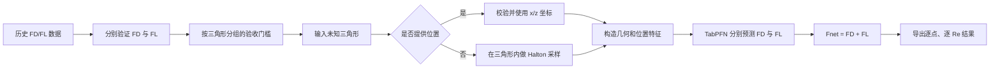

# FD、FL 到 Fnet 的验证与推理闭环

> 2026-09-10 更正：当前训练构造代码直接把 FD 文件的 `u` 写入 `fd_x_pred`，尚无已确认的单位换算依据。因此下文历史的 `FD + FL` 只代表旧接口算术行为，不能视为已验证的物理合力；聚焦分数与曲率修正也仍是经验规则。新的预测、统计及限制见 [FD/FL 改进说明](FD_FL_PREDICTION_IMPROVEMENTS.md)。

## 1. 闭环目标

项目最终要回答一个问题：给定一个未知三角形、曲率半径和若干雷诺数，在指定位置预测 `FD` 与 `FL`，再合成 `Fnet`。



## 2. 现有数据能证明什么

### FL：已证明同一三角形内的位置插值能力很好

`data/rawdata/2026-07-10` 的 3 个文件按文件内原始点做 3 折留出验证，TabPFN 结果如下：

| 文件 | MAE | RMSE | R2 |
| --- | ---: | ---: | ---: |
| `690-10-FLX-无插值.xlsx` | 0.000179 | 0.000500 | 0.999338 |
| `720-10-FLX-无插值.xlsx` | 0.000153 | 0.000560 | 0.998942 |
| `770-10-FLX-无插值.xlsx` | 0.000137 | 0.000428 | 0.999133 |

证据文件：`results/interpolated_2026-07-10-tabpfn/summary.csv`。

这个结论只适用于“已知三角形内预测未测位置”，不能直接等价为“预测全新三角形”。

### FD：同一几何跨半径预测整体可用，但存在失败半径

`data/rawdata/2026-06-20` 的 TabPFN FD 实验使用同一几何的其他半径训练，再预测留出的半径：

- 共 13 个留出任务；`R2` 中位数为 `0.7095`。
- 10/13 个任务的 `R2 >= 0.65`。
- Pearson 相关系数中位数为 `0.9871`，最低为 `0.9753`，场形趋势较稳定。
- 3 个半径 30 任务的 `R2` 为负，说明幅值校准并非在所有半径上都可靠。

证据文件：`results/fd_u_from_fl_2026-06-20/metrics.csv`。

### 未知三角形：目前还不能宣称验证良好

严格按完整三角形留出的 FL 旧实验为：14 个文件、5 折、加权 `R2=-1.5775`。证据文件：`results/triangle_5fold_cv/summary.csv`。

FD 的按文件分组结果在半径 10 上约为 `R2=0.51~0.52`，且使用的是 `ExtraTreesRegressor`，不是 TabPFN。证据文件：`results/fd_2026-05-25_radius10_file_group_5fold_distance_features/summary_all_groups.csv`。

因此，当前最严谨的表述是：

> FD 和 FL 对已知几何内部位置、以及部分同几何跨半径任务已有较好结果；未知三角形外推的完整验证尚未通过。

## 3. 当前推理闭环

核心入口是 `web-demo/tabpfn_service.py`。

输入：

- 三角形三边：`side_ab_um`、`side_ac_um`、`side_bc_um`。
- 曲率半径：`curvature_radius_um`。
- 可选位置：`positions`，每个点使用 `x_um`、`z_um`。
- 雷诺数当前固定为 `6, 12, ..., 60`。

位置规则：

- 提供 `positions`：逐点检查是否位于三角形内，检查通过后直接使用。
- 不提供 `positions`：在三角形内部自动生成 400 个 Halton 低差异采样点。

每个点的主要输出：

```text
fl_pred
fd_pred
fnet_pred = fl_pred + fd_pred
fnet_x
fnet_z
fnet_magnitude = sqrt(fnet_x^2 + fnet_z^2)
```

为兼容网页，原有 `fl_x_pred`、`fd_x_pred`、`total_force_x`、`total_force_y` 和 `total_force_magnitude` 字段继续保留。

## 4. 直接运行

使用用户给定位置：

```powershell
cd D:\2026\tab\FDFLPredictions
.\.venv\Scripts\python.exe web-demo\tabpfn_service.py `
  --model-dir models\tabpfn_server_500 `
  --predict-json web-demo\examples\triangle_with_positions.json `
  --output-json results\triangle_force_with_positions.json
```

不提供位置、自动采样：

```powershell
.\.venv\Scripts\python.exe web-demo\tabpfn_service.py `
  --model-dir models\tabpfn_server_500 `
  --predict-json web-demo\examples\triangle_auto_sample.json `
  --output-json results\triangle_force_auto_sample.json
```

判断是否真正使用 TabPFN：检查输出中的：

```json
"uses_tabpfn": true
```

如果为 `false`，服务使用的是规则回退结果，不能作为模型预测结果。

## 5. 数据与代码对应关系

| 环节 | 数据或代码 |
| --- | --- |
| FL 表内能力验证 | `data/rawdata/2026-07-10`、`src/regression/raw_fl_tabpfn.py` |
| FD 同几何跨半径验证 | `data/rawdata/2026-06-20`、`src/regression/fd_from_fl.py` |
| 未知三角形 FL 严格验证 | `src/regression/evaluation.py` |
| 服务训练表生成 | `web-demo/build_training_csv_from_local_data.py` |
| TabPFN 模型训练 | `web-demo/train_tabpfn_models.py` |
| 未知三角形与 Fnet 推理 | `web-demo/tabpfn_service.py` |
| 当前服务训练数据 | `models/tabpfn_server/training.csv`，7829 行、14 个匹配文件 |
| 当前推理模型 | `models/tabpfn_server_500/*.joblib` |

## 6. 尚需完成的科学验收

当前 `training.csv` 没有保留 `source_file` 或 `geometry_id`，无法直接进行防泄漏的按三角形交叉验证；而且 `fl_y_pred` 与 `fd_y_pred` 是 0 占位标签。当前可信的主输出应是单方向投影 `fnet_pred = fl_pred + fd_pred`，二维 `Fnet` 只用于接口兼容。

正式宣称“可预测未知三角形”之前，应完成：

1. 在训练表中保留 `source_file`、`geometry_id`、`radius_id`。
2. 使用 `GroupKFold(groups=geometry_id)`，让同一三角形的所有位置和 Re 只能出现在同一折。
3. FD、FL 分别达到预先约定的未知几何指标门槛，再评估 Fnet 误差。
4. 对超出训练几何范围的输入给出 OOD 警告，不把外推值伪装成高置信度结果。

建议验收门槛：未知三角形分组验证中，FD 与 FL 均满足 `R2 >= 0.80`、归一化 RMSE `<= 10%`；Fnet 再单独检查方向与幅值误差。
